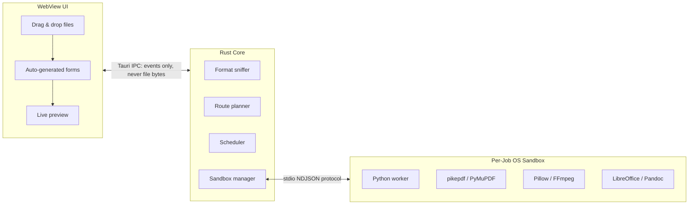

[](LICENSE)
[](#platform-support)
[](https://www.rust-lang.org/)
[](CONTRIBUTING.md)

# Local File Conversion Suite

**A privacy-first file converter and toolkit that processes everything on your machine. No uploads. No telemetry. No cloud. Ever.**

Convert between 41+ file formats — documents, images, audio, video, and data — with a full suite of editing tools for PDFs, images, audio, video, and spreadsheets. Every job runs inside a per-job operating system sandbox with zero network access, so your files never leave your device.

<br>

## Why This Project?

Most file conversion tools upload your files to a remote server. That means your contracts, medical records, financial documents, personal photos, and private audio pass through infrastructure you don't control — often with vague privacy policies and no deletion guarantees.

**Local File Conversion Suite takes a different approach:**

- **Zero network code** — The application contains no HTTP clients, no WebSocket connections, no telemetry, no crash reporters, no update checkers, and no font downloaders. There is literally no code path that can send data anywhere.
- **Per-job OS sandbox** — Every conversion runs in its own operating system sandbox (macOS Seatbelt) that can only access the job's private working directory. It cannot read your home folder, other jobs, or the network.
- **Verified at startup** — The sandbox runs a self-test every time the app launches. If it fails, all processing is disabled. The app never runs a conversion without sandbox protection.
- **No history** — Nothing about your files survives a restart. No recent files list. No logs containing file names or document text. Passwords are held in memory only.
- **Independently tested** — A canary test runs every tool against documents whose metadata points at a local listener, and fails if anything connects. A packet-capture test records every packet during a full run.

> Read the full [Privacy Policy](docs/privacy.md) for implementation details and test methodology.

<br>

## Features at a Glance

### Format Conversion (41+ Formats)

| Category | Formats |
|---|---|
| **Documents** | PDF, Word (.docx), PowerPoint (.pptx), Excel (.xlsx), OpenDocument (.odt/.odp/.ods), RTF, EPUB, Markdown, HTML, Plain Text |
| **Data** | CSV, JSON, YAML |
| **Images** | PNG, JPG, WebP, HEIC, GIF, SVG, TIFF, AVIF, BMP, ICO |
| **Audio** | MP3, WAV, FLAC, OGG, Opus, M4A, AAC, AIFF |
| **Video** | MP4, MOV, MKV, WebM, AVI |

Mixed selections are supported — drop Word files, photos, and spreadsheets together and convert them all to PDF in one go.

### PDF Toolkit

| Tool | What It Does |
|---|---|
| **Merge** | Combine multiple PDFs into one, with per-file bookmarks |
| **Split** | Break a PDF by page ranges, bookmarks, or maximum size |
| **Organize** | Reorder, rotate, duplicate, or delete pages |
| **Compress** | Reduce file size by recompressing embedded images |
| **Page Numbers** | Add page numbers with configurable position and format |
| **Protect / Unlock** | Set or remove passwords and permissions |
| **Watermark** | Add text watermarks with custom placement and opacity |
| **Redact** | Search and redact text, draw redaction boxes, with independent verification |

### Image Tools

Rotate, resize, compress to a target file size, create animated GIFs, and combine images into a single PDF.

### Audio Tools

Join audio files, adjust volume, add fade in/out, and change playback speed.

### Video Tools

Join clips, rotate, change speed, and extract frames as images at set intervals.

### Spreadsheet Tools

Combine multiple CSV or Excel files into one, or split a file by row count or column value.

### Safety and Privacy Tools

| Tool | What It Does |
|---|---|
| **Inspect** | Shows what a file reveals: GPS location, camera/device info, author, dates, comments, tracked changes, macros, scripts, and hidden content — all detected locally |
| **Remove Hidden Details** | Strips metadata from photos (EXIF/GPS), PDFs, Office files, audio, and video — without changing pixels or re-encoding sound |
| **Make Safe to Open** | Removes macros, ActiveX, scripts, embedded files, and external links from PDFs, Office files, SVG, and web pages. An independent verifier in a separate process confirms nothing active remains |

<br>

## How It Works



**Architecture highlights:**

- **Rust core** handles supervision, file detection, job scheduling, sandboxing, and saving — all trusted code with no network access
- **Python workers** run the actual conversion engines (pikepdf, PyMuPDF, Pillow, FFmpeg, LibreOffice, Pandoc) inside isolated OS sandboxes
- **Tauri 2 + React** provides the desktop UI; the WebView never touches file bytes
- **Adapters** are self-contained Python modules — each declares its capabilities in a `manifest.yaml` and parameter schema, and the registry is auto-generated at build time
- **stdio NDJSON** protocol connects core and workers — no loopback HTTP server, so no localhost attack surface

<br>

## Quick Start

### Prerequisites

| Tool | Version | Purpose |
|---|---|---|
| [Rust](https://rustup.rs/) | See `rust-toolchain.toml` | Core engine and app shell |
| [Node.js](https://nodejs.org/) | 22 or newer | Frontend tooling |
| [pnpm](https://pnpm.io/) | See `packageManager` in `package.json` | JavaScript workspace manager |
| [uv](https://docs.astral.sh/uv/) | Latest | Python workspace; installs the pinned Python itself |

**Platform-specific:**

- **macOS:** Xcode Command Line Tools (`xcode-select --install`)
- **Windows:** Microsoft C++ Build Tools and WebView2
- **Linux:** See packages listed in `.github/workflows/ci.yml`

**Optional engines** (the app shows the install command when they're missing):

- [FFmpeg](https://ffmpeg.org/) — required for audio and video conversions
- [LibreOffice](https://www.libreoffice.org/) — required for Office document conversions

> **Important:** Do not clone this repo into OneDrive, Dropbox, iCloud Drive, or Google Drive. Build output and test files would sync to the cloud.

### Setup

```bash
# 1. Clone the repository
git clone https://github.com/shamith-s-poojari/Local-File-Conversion-Suite.git
cd Local-File-Conversion-Suite

# 2. Install JavaScript dependencies
pnpm install

# 3. Install Python dependencies
uv sync

# 4. Start the development server
pnpm dev
```

### Build for Production

```bash
pnpm build
```

### Run All Checks

```bash
pnpm check
```

This runs the full CI pipeline locally: TypeScript type checking, JavaScript tests, `cargo fmt`, `cargo clippy`, `cargo test`, adapter registry validation, `ruff` linting, and `pytest`.

<br>

## Command Line Interface — `lfcs`

The CLI provides the same sandboxed conversion and tools as the desktop app, for scripting and automation.

```bash
# Build the CLI
cargo build -p lfcs
```

### Examples

```bash
# System diagnostics
lfcs doctor                                    # Sandbox self-test, engines, adapters

# Inspect files
lfcs inspect report.pdf photo.heic             # Format, size, pages, metadata findings
lfcs targets report.pdf                        # Available conversions and tools

# Convert files
lfcs convert photo.png --to jpg                # Single file conversion
lfcs convert scans/ --to pdf --out out/        # Batch convert a folder
lfcs convert scans/ --to pdf --keep-folders    # Preserve folder structure
lfcs convert clip.mp4 --to png --set mode=interval --set every=10

# Run tools
lfcs run pdf-merge a.pdf b.pdf --out merged.pdf
lfcs run pdf-split big.pdf --out pieces/
lfcs run pdf-merge a.pdf b.pdf --json          # Machine-readable JSON output
```

### CLI Options

| Option | Description |
|---|---|
| `--to FORMAT` | Target format for `convert` |
| `-o, --out PATH` | Output location (default: current directory) |
| `--set KEY=VALUE` | Set a parameter (repeatable; overrides `--params`) |
| `--params JSON` | Parameters as a JSON object |
| `--keep-folders` | Preserve input folder structure in output |
| `--force` | Overwrite existing output file |
| `--json` | Machine-readable JSON output on stdout |
| `-q, --quiet` | Suppress progress output on stderr |

### Exit Codes

| Code | Meaning |
|---|---|
| `0` | Success |
| `1` | Job failed or partially succeeded |
| `2` | Usage error |
| `3` | Sandbox unavailable — self-test failed |

> Full CLI documentation: [apps/cli/README.md](apps/cli/README.md)

<br>

## Repository Layout

```
Local-File-Conversion-Suite/
├── apps/
│   ├── desktop/          # React UI + Tauri 2 shell (src-tauri/)
│   └── cli/              # lfcs command-line interface
├── crates/               # Rust libraries
│   ├── app-core/         #   Application logic, config, file intake
│   ├── sniffer/          #   Format detection from file content
│   ├── router/           #   Conversion graph and route planning
│   ├── scheduler/        #   Resource-aware job scheduling
│   ├── sandbox/          #   OS sandbox (Seatbelt, bubblewrap, AppContainer)
│   ├── jobstore/         #   Job directory management and cleanup
│   └── protocol/         #   Worker protocol codec and types
├── adapters/             # 30+ self-contained conversion/tool modules
├── workers/              # Adapter SDK and conformance test kit
├── packages/
│   └── protocol/         # Protocol schema, fixtures, code generator
├── docs/                 # Architecture, specs, ADRs, spike reports
│   ├── architecture/     #   System blueprint
│   ├── specs/            #   Phase specifications
│   ├── adr/              #   Architecture Decision Records
│   ├── privacy.md        #   Privacy policy and test methodology
│   └── known-limits.md   #   Known limitations
└── tools/                # Development and testing utilities
```

<br>

## Platform Support

| | macOS | Linux | Windows |
|---|---|---|---|
| **Sandbox** | Seatbelt — working | Bubblewrap — written, not yet verified | AppContainer — written, compile-checked only |
| **Engine Discovery** | Homebrew, `/Applications` | Standard package paths | WinGet, Scoop, Chocolatey, Program Files |
| **Installer** | Not yet built | Not yet built | Not yet built |

The app currently runs from a development checkout on all platforms. Packaging, signing, and notarization are planned.

<br>

## Documentation

| Document | Description |
|---|---|
| [Architecture Blueprint](docs/architecture/blueprint.md) | Full system design, decisions, and diagrams |
| [Phase 1 Specification](docs/specs/phase-1.md) | Detailed implementation spec (wins over blueprint where they differ) |
| [Architecture Decision Records](docs/adr/) | Key design decisions and their rationale |
| [Privacy Policy](docs/privacy.md) | What "processed on your device" means and how it's tested |
| [Known Limitations](docs/known-limits.md) | Current platform and feature limitations |
| [CLI Reference](apps/cli/README.md) | Full command-line interface documentation |
| [Adapter Guide](adapters/README.md) | How adapters work and how to add one |
| [Protocol Reference](packages/protocol/README.md) | Worker protocol schema and fixtures |

<br>

## Contributing

Contributions are welcome! Whether it's a bug fix, a new adapter, documentation improvements, or feature suggestions — we'd love your help.

Please read [CONTRIBUTING.md](CONTRIBUTING.md) before submitting a pull request.

The easiest way to contribute is to **add a new adapter** — each adapter is a self-contained Python module, and adding one requires no changes to any shared file.

<br>

## Security

For reporting vulnerabilities, please see [SECURITY.md](SECURITY.md). Do **not** open a public GitHub issue for security reports.

<br>

## License

[GNU Affero General Public License v3.0 only](LICENSE) (AGPL-3.0-only).

<br>

## Acknowledgments

Built with these outstanding open-source projects:

| Project | Role |
|---|---|
| [Tauri](https://tauri.app/) | Desktop application framework |
| [pikepdf](https://pikepdf.readthedocs.io/) | Structural PDF operations |
| [PyMuPDF](https://pymupdf.readthedocs.io/) | PDF rendering and redaction |
| [Pillow](https://pillow.readthedocs.io/) | Image processing |
| [FFmpeg](https://ffmpeg.org/) | Audio and video processing |
| [LibreOffice](https://www.libreoffice.org/) | Office document conversion |
| [Pandoc](https://pandoc.org/) | Document format conversion |

---

<p align="center">
  <b>Your files. Your machine. Your privacy.</b>
</p>
