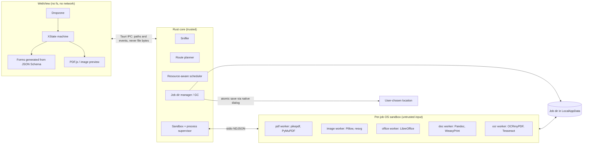
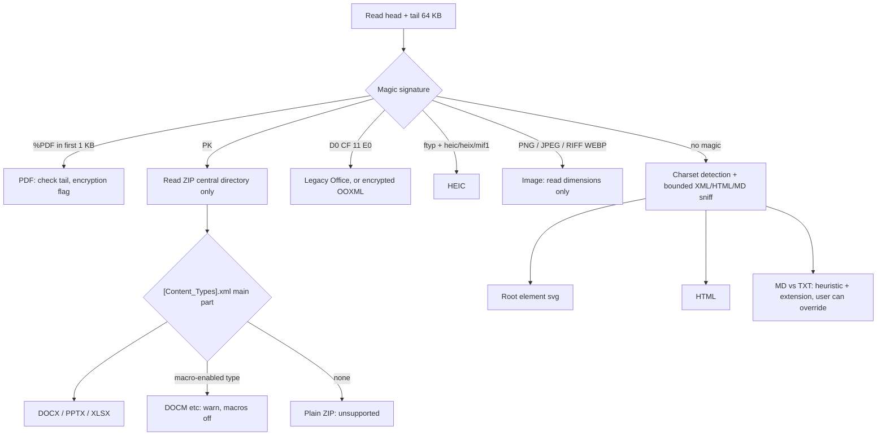
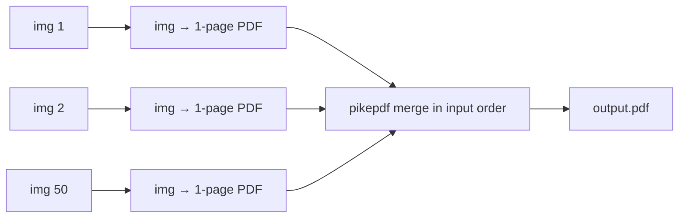
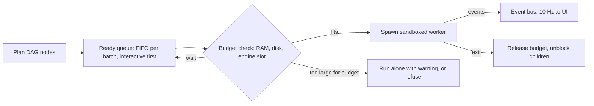
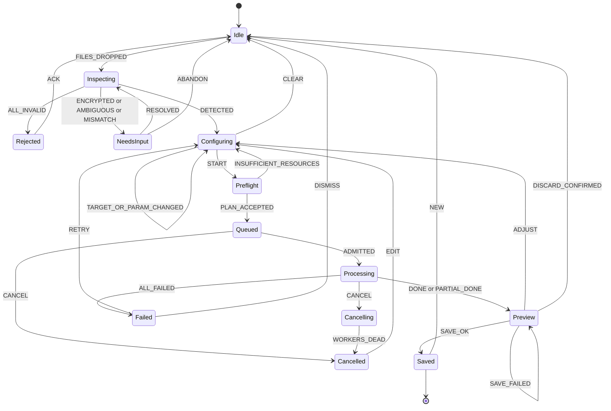

# Local File Conversion Suite: System Architecture Blueprint

**Status:** Approved and scope locked. References to Q1 to Q5 mean the choices now recorded in section 10. Implementation follows the [Phase 1 specification](../specs/phase-1.md), which wins wherever the two differ.

## Context

We are building a multi-format converter and PDF toolkit in which all processing happens on the user's machine. It detects formats from file content and offers only targets it can deliver with honest fidelity. The working folder is empty, so this is a greenfield design.

Library licenses, versions and all sizes and memory figures below are planning estimates. Phase 1 pins and measures them.

### Decisions at a glance

| Question | Decision |
|---|---|
| Paradigm | **Hybrid: Tauri 2 desktop app, Rust supervisor, sandboxed Python/native worker processes.** No loopback HTTP server. |
| Hardest problem | Office to PDF fidelity. LibreOffice headless with metric-compatible fonts, plus optional Word automation on Windows. |
| Structural PDF ops | pikepdf (qpdf) |
| Redaction, rendering | PyMuPDF (AGPL, see Q2), verified after every redaction |
| Images | Pillow, pillow-heif, img2pdf, resvg, svg2pdf |
| Reflowable documents | Pandoc, using its AST as the intermediate representation |
| Dropped from your list | FFmpeg (no audio/video in scope), ImageMagick (large attack surface, nothing Pillow lacks here), all Wasm engines in v1 |

### Three corrections to the brief

1. **The conversion graph is not a DAG.** PDF ↔ DOCX is a cycle, so the *format graph* is a general directed graph. The *execution plan* for one job is the DAG. Section 3.3 separates the two.
2. **"Only lossless targets" conflicts with "PDF → DOCX/PPTX/XLSX".** PDF stores positioned glyphs, not paragraphs or tables, so reverse conversion is always a reconstruction. These routes are labelled best-effort and hidden by default (Q4).
3. **Keep the repo out of cloud-synced folders such as OneDrive.** Anything there syncs to the cloud, including test files and build output. The product must handle the same trap for its users (section 6.5).

---

## 1. Architecture evaluation

| Criterion | A: Browser + Wasm | B: Desktop + native workers |
|---|---|---|
| Office → PDF fidelity | **Weak.** Requires a very large LibreOffice Wasm build, and is slow and hard to debug | **Strong.** Full LibreOffice, optional real Word |
| 500 MB+ PDFs | **Risky.** wasm32 caps at 4 GiB, and practical limits are lower and vary by browser | **Good.** Lazy parsing, disk-backed, native tools |
| OCR and compression | Slow (tesseract.js, no complete Ghostscript pipeline) | Native Tesseract, OCRmyPDF, Ghostscript |
| Malicious file isolation | Good browser sandbox, but memory exhaustion can kill the tab | OS sandbox must be **built by us**; per-process limits and clean kill |
| Install friction | **None** | Installer, code signing, large download |
| Privacy credibility | **Strong and inspectable** in devtools | Must be proven (section 6.5) |
| Saving and batch output | Good only on Chromium (File System Access API) | Native |
| Student team effort | Low to start; painful at engine boundaries (threads need COOP/COEP, Wasm debugging) | Higher packaging effort; engines work as documented |

**Why not a loopback server (the common version of B).** Any website the user visits can send requests to `localhost`, so a local server needs auth tokens, origin checks and DNS-rebinding defenses. Stdio pipes to child processes have no such exposure and need no port.

**Why Tauri over Electron.** Tauri's small-binary advantage is irrelevant here, because the engines will dominate the download. The real reasons are its deny-by-default capability model and a renderer with no Node access. **Electron is an acceptable fallback** if nobody on the team will own about 2,000 lines of Rust: it also gives consistent Chromium and built-in HTML printing, at the cost of more hardening work.

**Why Python workers.** The best libraries for this domain are Python bindings. Rust stays small: supervision, IPC, sandboxing, file sniffing. Students write adapters in Python.

**Keeping a web version possible.** Adapters talk through a language-neutral protocol, so a later "Lite" web build could reimplement a subset. Not in v1.

### System diagram



**Core invariants**

- File bytes never cross the UI IPC.
- Workers can touch only their job directory.
- Only the Rust core writes to the user's chosen location.
- Nothing in the app has network access.

---

## 2. Format detection

Extensions are only a tie-breaker. The sniffer runs in Rust, reading the first and last 64 KB of the file without parsing it deeply.



The result is a `FileDescriptor`: format, confidence, evidence, extension mismatch, encryption state and basic metadata. Page counts and other deep inspection happen later, inside a sandboxed worker.

Three edge cases have explicit behavior:

- **Extension mismatch:** warn and trust the content.
- **Polyglot files** (valid as two formats): require the user to choose.
- **Markdown:** has no signature, so it is always overridable.

---

## 3. Section A: Compatibility matrix and routing engine

### 3.1 Fidelity tiers

Every edge declares one tier, and the UI shows it as a badge.

| Tier | Meaning | Default UI |
|---|---|---|
| **E** Exact | Pixels or content preserved with no generational loss | Shown |
| **H** High | Visually or semantically near-identical; known caveats listed | Shown |
| **R** Reconstructed | Structure is inferred; expect manual cleanup | Hidden behind "Show best-effort" |
| **L** Lossy by nature | Discards something inherent (alpha, formatting, compression loss) | Shown with a stated reason |

Note that "exact" means no *further* loss. JPG → PNG preserves the decoded pixels but cannot restore what JPEG already discarded.

### 3.2 Matrix

```
FROM \ TO  PDF  DOCX PPTX XLSX MD   HTML TXT  PNG  JPG  WEBP SVG  HEIC
PDF        ops  R    R    R    R    R    R*   H    L    L    H    -
DOCX       H    .    -    -    R    R    L    H²   L²   L²   -    -
PPTX       H    -    .    -    -    -    L    H²   L²   L²   -    -
XLSX       H    -    -    .    -    R    L    H²   L²   L²   -    -
MD         H    H    R    -    .    H    L    -    -    -    -    -
HTML       H    R    -    -    R    .    L    -    -    -    -    -
TXT        H    H    -    -    H    H    .    -    -    -    -    -
PNG        E    -    -    -    -    -    -    .    L    E    -    -
JPG        E    -    -    -    -    -    -    E    .    L    -    -
WEBP       E    -    -    -    -    -    -    E    L    .    -    -
SVG        H    -    -    -    -    -    -    H    L    H    .    -
HEIC       H    -    -    -    -    -    -    H    L    L    -    .

² = two hops through PDF     - = deliberately not offered
R* = exact when the PDF has a text layer; offers OCR when it does not
```

**Deliberately not offered**

- **Anything → HEIC:** encoding brings x265 (GPL) and HEVC patent exposure. This narrows your "HEIC ↔ PDF" to one direction.
- **Raster → SVG:** this is tracing, not conversion. VTracer could be a later, separate "Vectorize" tool.
- **Raster → DOCX/XLSX:** this is an OCR product of its own.

### 3.3 Conversion graph

**Nodes** are formats, each tagged with an information level:

```
Structured  (DOCX, PPTX, XLSX, MD, HTML, TXT)    semantics exist
    ↓
Fixed layout (PDF, SVG)                          positions exist
    ↓
Raster      (PNG, JPG, WEBP, HEIC)               only pixels exist
```

**Edges** are adapters, declared in manifests.

**Intermediate representations**

| Domain | Hub | Why |
|---|---|---|
| Reflowable documents | Pandoc AST | N formats need N readers and N writers, not N² converters |
| Office → fixed layout | LibreOffice's internal model | Treated as one direct edge; we do not chain through ODF |
| Images | Decoded pixel buffer + ICC profile + EXIF | Avoids generational re-encoding |
| Fixed-layout output | PDF | Office → PNG is Office → PDF → PNG |

**Routing rules**

1. **Moving down a level is normal; moving back up is reconstruction.** Any path that goes up is capped at tier R.
2. **Never route structured → PDF → structured.** DOCX → PDF → MD is blocked because a direct, better edge exists.
3. **Maximum 3 hops.** The graph is small (about 12 nodes), so we enumerate simple paths rather than build anything clever.
4. **Rank lexicographically, not by summed weights:** worst tier on the path, then number of lossy hops, then hop count, then estimated cost. Numeric weights would let a cheap lossy path beat a slower lossless one.
5. **Availability filter:** remove edges whose engine is missing (for example, no Office pack installed).

**The plan for one job is the DAG.** "50 images → one PDF" fans out and back in, so one bad image cannot take down the batch, and memory stays bounded.



**Batch target selection:** group files by format and offer each group's own targets. Offer a shared target such as "all to PDF" only where every group supports it.

**CI invariants, computed from the manifests**

- Every matrix cell marked as offered yields a plan.
- Each plan's tier matches the matrix.
- No plan violates routing rules 1 to 3.

### 3.4 Adapter architecture

Every adapter is a folder that is discovered at build time. Adding one edits **no shared file**.

```yaml
# adapters/image-to-pdf/manifest.yaml (illustrative)
id: image-to-pdf
edges:
  - { from: [png, jpg], to: pdf, tier: E }
  - { from: [webp], to: pdf, tier: E }
worker: image
limits: { max_input_mb: 500, timeout_s_per_mb: 2 }
params_schema: ./params.schema.json   # UI form is generated from this
platforms: [windows, macos, linux]
requires: []
```

| Method | Contract | Rules |
|---|---|---|
| `validateInput(ctx)` | Deep checks; returns errors, warnings and metadata (pages, dimensions, fonts) | Runs in the sandbox. Must not fully decode. Bounded time. |
| `estimateMemory(ctx, params)` | Returns peak RAM, temp disk, and cost units | Pure and fast. Feeds scheduler admission. Calibrated by benchmarks. |
| `executeConversion(ctx, params, emit)` | Writes only to `ctx.out`; emits progress, warnings, result | Must honor cancel. Must report fidelity warnings. Never writes to `argv` or logs any password. |
| `cleanup(ctx)` | Releases adapter-owned resources | Idempotent and safe after a crash. **The core deletes the job dir regardless**, so cleanup is never relied upon for safety. |

**Worker protocol:** NDJSON over stdio, schema-versioned. One JSON schema generates both the TypeScript types and the Pydantic models.

```
→ {"type":"execute","jobId":"…","input":["in/a.pdf"],"out":"out/","params":{…}}
← {"type":"stage","name":"render","index":2,"of":4}
← {"type":"progress","stage":"render","done":37,"total":120}
← {"type":"warning","code":"FONT_SUBSTITUTED","detail":{"from":"Aptos","to":"Carlito"}}
← {"type":"result","outputs":[{"path":"out/a.pdf","sha256":"…"}],"fidelity":"H"}
```

An **adapter conformance kit** runs against every adapter automatically: rejects corrupt input, respects the output directory, honors cancel, memory estimate within tolerance, leaves nothing behind.

---

## 4. Section B: Library mapping and fidelity traps

### 4.1 PDF operations

| Operation | Engine | Notes |
|---|---|---|
| Merge, split, rotate, reorder | **pikepdf** | Must also handle bookmarks and colliding form field names |
| Compress, lossless stage | **pikepdf** | Object streams, recompress Flate, drop unreferenced objects |
| Compress, lossy stage | **Ghostscript** `pdfwrite` | `-dSAFER`. Presets by image DPI. **If the output is larger, keep the original.** |
| Redact | **PyMuPDF** `apply_redactions` | Followed by the mandatory verification below |
| Watermark | **pikepdf** overlay | Stamp generated by ReportLab. Respect CropBox and `/Rotate`. |
| Protect, unlock | **pikepdf** | AES-256. Passwords move over stdin only. |
| OCR | **OCRmyPDF** + **Tesseract** | `--skip-text` by default. Set `OMP_THREAD_LIMIT=1`. |
| Thumbnails, rasterize | **PyMuPDF** (or pypdfium2 if permissive licensing is needed) | Rendered in the worker |
| In-app viewing | **PDF.js** | `isEvalSupported: false`. Keep updated (CVE-2024-4367). |

**Redaction verification.** A black box drawn over text is the classic failure: the text is still there. After redaction, a separate step must:

1. Re-extract text in each redacted region and confirm it is empty.
2. Search the whole document for the redacted strings.
3. Strip metadata, XMP, attachments, annotations and hidden layers.
4. Save a full rewrite with garbage collection, **never** an incremental save, which would keep the old content in the file.

If verification fails, the user receives no output. The fallback offer is to rasterize the affected pages.

### 4.2 Conversions

| Pair | Engine | Tier |
|---|---|---|
| DOCX, PPTX, XLSX → PDF | **LibreOffice headless**; optional **Word/PowerPoint/Excel via COM** on Windows | H |
| DOCX ↔ MD, HTML; MD ↔ HTML; TXT → MD, DOCX | **Pandoc** with `--sandbox` | H or R |
| MD → PDF | Pandoc → HTML → **WeasyPrint** | H |
| HTML, TXT → PDF | **WeasyPrint** with a local-only URL fetcher | H |
| DOCX, PPTX, XLSX → TXT | Pandoc, python-pptx, openpyxl (read-only) | L |
| PDF → TXT | **PyMuPDF** | R |
| PDF → MD, HTML | PyMuPDF with layout heuristics | R |
| PDF → DOCX | **pdf2docx** | R |
| PDF → XLSX | **pdfplumber** + openpyxl | R, tables only |
| PDF → PPTX | Page images on slides via python-pptx | R, not editable |
| PDF → PNG, JPG, WEBP, SVG | **PyMuPDF** | H or L |
| PNG, JPG → PDF | **img2pdf** (embeds without re-encoding) | E |
| WEBP, HEIC → PDF | Pillow / **pillow-heif** decode → PNG → img2pdf | E, H |
| Raster ↔ raster | **Pillow** + pillow-heif | E or L |
| SVG → PNG, WEBP | **resvg** (no scripts, no network) | H |
| SVG → PDF | **svg2pdf** (keeps vectors) | H |

### 4.3 Fidelity traps

| Trap | What goes wrong | Solution |
|---|---|---|
| **Missing fonts in DOCX/PPTX** | Different widths reflow text, shifting page breaks and tables | Bundle Carlito (Calibri), Caladea (Cambria), Liberation (Arial, Times, Courier), and Noto for CJK and fallback. Compare requested and embedded fonts, then raise `FONT_SUBSTITUTED`. |
| **Aptos, the current Office default** | No metric-compatible free clone that we know of, so modern documents will reflow | Warn clearly, and prefer the Word adapter where available |
| **Complex DOCX layout** | Floating anchors, nested tables, SmartArt, some equations render differently | Word COM adapter when installed (macros force-disabled). Otherwise measure on a golden corpus and publish known limits. |
| **Tracked changes** | Export may show revisions | Detect and ask: final or marked up |
| **XLSX pagination** | Wide sheets split across many pages | Default to fit-to-width through LibreOffice UNO on a temp copy. Do **not** round-trip through openpyxl, which drops features. |
| **XLSX recalculation** | Different computed values from the original | Configure LibreOffice to never recalculate on load, keeping cached values |
| **PPTX** | Animations flatten; SmartArt and fonts drift | Warn; offer a notes-pages option |
| **Concurrent LibreOffice** | A shared profile makes runs fail, sometimes silently | Unique `-env:UserInstallation` per worker; **verify the output exists and is a valid PDF** |
| **Image color and orientation** | Lost ICC profile washes out colors; ignored EXIF rotates photos | Preserve ICC, apply EXIF orientation, test both |
| **Alpha → JPG** | Transparency turns black | Flatten on a chosen color; warn |
| **HEIC specifics** | 10-bit content, multi-image containers, GPS in metadata | 16-bit PNG option, one output per image, strip location by default |
| **JS-driven HTML** | WeasyPrint runs no JavaScript | Documented limit: static HTML only. We prefer this to shipping Chromium's attack surface. |
| **WeasyPrint on Windows** | Needs Pango native libraries | Packaging spike in Phase 1. Fallback: Typst for MD → PDF. |

### 4.4 License audit

| License | Components | Effect |
|---|---|---|
| **AGPL or commercial** | PyMuPDF (so pdf2docx in practice), Ghostscript | **Forces a decision (Q2)** |
| **GPL, separate process** | Pandoc | Distribution obligations; run as a separate executable |
| **MPL / LGPL** | LibreOffice, pikepdf, OCRmyPDF, img2pdf, libheif | Fine with notices |
| **Permissive** | qpdf, Pillow, PDF.js, Tesseract, WeasyPrint, pypdfium2, pdfplumber, resvg | Fine with notices |

CI runs `cargo-deny`, `pip-licenses` and a pnpm license check, failing on anything unapproved. Permissive path if needed: pypdfium2 for rendering, pikepdf + image re-encoding for compression, and **rasterize-only redaction** in place of PyMuPDF.

---

## 5. Section C: Concurrency, memory and streaming

### 5.1 Scheduler



- **RAM budget:** `min(60% of available RAM, user setting)`, re-read before each admission.
- **Admission:** a job starts only if its estimate fits. A job larger than the whole budget runs alone, so big jobs cannot starve forever.
- **Disk preflight:** require `input size × adapter factor` free, or fail before starting.

| Pool | Slots | Isolation |
|---|---|---|
| Image | `min(cores − 1, 4)` | Reused within a batch; recycled after 50 tasks or RSS threshold |
| PDF structural | 2 | One process per job |
| Ghostscript, render | 1 to 2 | One process per job |
| Office | 1 (2 if RAM ≥ 16 GB) | One process and profile per job |
| OCR | 1 job, `cores − 1` page threads | One process tree per job |

**Initial memory estimates (to calibrate with benchmarks)**

| Engine | Estimate |
|---|---|
| Pillow | `width × height × channels × bytes-per-channel × 1.5`, from the header alone |
| pikepdf | `64 MB + 0.3 × file size` |
| Render | `base + DPI²-scaled page area × concurrent pages` |
| LibreOffice | `600 MB + 3 × uncompressed OOXML size` |

Estimates are **advisory**. The hard limit is enforced by the OS (section 6.3), so a wrong estimate means a failed job, not a frozen machine. Failures from hitting the limit retry once, alone, with a larger budget.

### 5.2 Large file handling

| Scenario | Approach |
|---|---|
| **500 MB+ PDF, viewing** | PDF.js range requests over a scoped asset protocol; auto-fetch off; render only visible pages; worker-generated thumbnails cached on disk and loaded lazily |
| **500 MB+ PDF, processing** | Inputs are hard-linked (or copied across volumes) into the job dir. pikepdf loads objects lazily. Multi-file output goes straight to disk. |
| **50-image batch** | Per-image processes, header-based estimates, fan-in merge from disk |
| **Output** | Write to temp, flush, then atomic rename. Partial output is never visible. |
| **Cloud placeholders** | Detect OneDrive-style dehydrated files before reading, since reading triggers a download |

### 5.3 Progress and cancellation

```
Worker NDJSON → Rust supervisor (validate, assign seq) → job store (authoritative) → Tauri event → UI
```

- **Overall progress** = weighted stages. Weights are per-adapter and improve with measured timings.
- **Engines without progress** (LibreOffice, some Ghostscript runs) show an indeterminate bar with stage name, elapsed time and page count from output. We don't fake percentages.
- **Reconnection:** events carry sequence numbers, so a reloaded UI can resync from the Rust job store.
- **Cancel:** send a request, wait 2 seconds, then kill the whole process tree via the Job Object.
- **Watchdog:** a timeout based on file size, plus a no-output timeout. LibreOffice and Ghostscript both need external heartbeat logic because they can hang silently.

### 5.4 Temporary files and garbage collection

```
%LOCALAPPDATA%/<App>/jobs/<jobId>/
    in/      read-only links to inputs
    work/    deleted when the job reaches a terminal state
    out/     kept until saved, dismissed or app exit
    .lease   PID + start time
```

| Trigger | Action |
|---|---|
| Job finished | Delete `work/` |
| Output saved or dismissed | Delete the job dir |
| App exit | Delete all job dirs |
| App start | Remove any job whose lease owner is dead (crash recovery) |
| Blocked delete on Windows | Retry with backoff; remove at next start |

**Honesty note:** we do not promise secure erasure, which is unreliable on SSDs. The docs say so.

---

## 6. Section D: Security and sandboxing

**Threat model:** the user is trusted; the *file* is not. Assume a parser will eventually be exploited (libwebp's CVE-2023-4863 shows that even common image decoders can be). The goal is that a compromised worker can read nothing else, reach no network, and exhaust no resources.

### 6.1 Threats and controls

| Threat | Control |
|---|---|
| **Zip bombs (DOCX, PPTX, XLSX)** | Inspect the central directory first. Limits: total uncompressed size, per-entry ratio, entry count. Reject overlapping entries and nested archives. Count actual bytes on extraction, because headers can lie. |
| **Zip slip** | Reject absolute paths and `..`. Prefer not extracting at all. |
| **XXE and billion laughs (DOCX, SVG)** | `defusedxml`, or lxml with `resolve_entities=False, no_network=True, huge_tree=False`. Reject any DOCTYPE in OOXML. |
| **Malicious SVG** | Scripts, `foreignObject` and external references are stripped or refused. Rendered by resvg. Previewed only through `` or as a rasterized PNG, **never inlined in the DOM**. |
| **Remote content in documents** | OOXML relationships with `TargetMode="External"` are flagged and neutralized. These are tracking and template-injection vectors, **and would break the privacy promise**. HTML uses a deny-all URL fetcher. |
| **Office macros** | LibreOffice profile: highest macro security, macros disabled, link updates off. Word COM with automation security force-disabled. |
| **PDF active content** | Never executed. PDF.js scripting off. Optional sanitize removes `/OpenAction`, `/AA`, `/JavaScript`, `/EmbeddedFiles`. Warn when found. |
| **Image bombs** | Read dimensions from the header and reject over the pixel limit before decoding. |
| **PDF bombs and malformed structure** | Worker RAM and CPU caps, page limits, timeouts. Run structure checks through qpdf in a worker. |
| **Ghostscript exploits** | `-dSAFER` always, no user-controlled arguments, and it only runs inside the sandbox |
| **Pandoc file reads** | `--sandbox` always, plus no raw HTML passed to the PDF path |
| **Passwords** | stdin only; never in `argv`, logs or job files; cleared after use. |
| **Log leakage** | Hash file names in logs; never log contents; no telemetry. |
| **Malicious file names** | Never used as worker paths. Inputs are renamed to `in/0.pdf`. Arguments are passed as an array, never through a shell. Reserved Windows names are sanitized at save. |

**Unlock policy.** Removing a permissions-only password technically needs no password, so we ask the user to confirm they have the right to do it. Files with an open password are never cracked or guessed.

### 6.2 Default limits (user-adjustable up to a hard ceiling)

| Limit | Default | Hard ceiling |
|---|---|---|
| Single file size | 2 GB | 10 GB |
| PDF pages | 5,000 | 50,000 |
| Image pixels | 200 MP | 1 GP |
| Uncompressed OOXML total | 2 GB | 8 GB |
| ZIP ratio per entry | 100:1 | 1000:1 |
| ZIP entries | 10,000 | 100,000 |
| Batch files | 200 | 2,000 |
| XML depth | 256 | 1024 |

### 6.3 Process sandbox

| Control | Windows (priority) | Linux | macOS |
|---|---|---|---|
| Memory, CPU, process count | **Job Object** with kill-on-close | cgroups v2 / rlimits | rlimits + supervisor watchdog |
| Filesystem | Restricted token, low integrity; **AppContainer where the engine tolerates it** | **bubblewrap** bind-mounting only the job dir | App Sandbox entitlement |
| Network | AppContainer without network capability | `--unshare-net` | App Sandbox without network entitlement |
| Syscalls | Win32k lockdown where possible | seccomp | Inherited |

**Known risk:** LibreOffice may not run under AppContainer. Phase 1 tests this directly. If it fails, the fallback is low integrity with firewall rules from the installer, and **we state that limitation in the docs rather than hide it.**

Workers also get a scrubbed environment, the job dir as their working directory, and no inherited handles.

### 6.4 Application hardening

- **Tauri capabilities:** no fs or http plugin in the renderer; only named commands. Every command validates its arguments in Rust.
- **CSP:** `default-src 'self'; connect-src ipc: http://ipc.localhost; script-src 'self'; object-src 'none'`.
- **Asset protocol** scoped to job directories.
- **Supply chain:** lockfiles with hashes, SBOM per release, `cargo-audit` and `pip-audit`, and a monthly engine update routine. Security updates matter because we ship parsers.

### 6.5 Proving the privacy claim

"Local-only" should be testable, not just asserted.

1. **Automated test:** run the whole corpus with outbound traffic captured, and fail on any packet. This includes files seeded with remote images and links.
2. **No network code in the app:** no update check, telemetry, crash upload or font download. Updates ship as manual downloads (Q3 can revisit this).
3. **Canary documents:** corpus files reference a local listener, proving that remote references do not resolve.
4. **Sync folder warning:** if the save location is inside OneDrive, Dropbox, iCloud or Google Drive, show one line: "This folder syncs to the cloud." Temp files stay in non-synced LocalAppData.
5. **Metadata:** the output's author, GPS and producer fields are reviewable, with a "strip metadata" option.

---

## 7. Section E: UI workflow and state machine

The Rust job store is authoritative. The UI runs an **XState v5** machine that mirrors it, so a UI reload cannot lose a running job.



| Stage | What the user sees | Guard or rule |
|---|---|---|
| **Idle / Dropzone** | Drop area, recent tools, "processed on your device" | Paths are held in memory only, with no recent-file history |
| **Inspecting** | Per-file detected type and evidence | Must never block the UI; bad files are marked individually, not the whole batch |
| **Configuring** | Only valid targets, with fidelity badges and warnings; form generated from `params_schema` | START disabled until params validate. "Show best-effort" reveals tier R. |
| **Queued / Processing** | Per-file progress plus a live stage log | One file's failure doesn't stop the others |
| **Preview** | Before and after view, warnings, output size, failed files with reasons | Saving is explicit; never overwrites an input by default |
| **Saved** | Open file, open folder, convert another | Job dir removed |

**Example stage log**

```
[00:00] Validated report.docx: 48 pages, no macros
[00:01] WARNING: font "Aptos" not available, using Carlito; layout may shift
[00:01] Starting Office engine
[00:09] Exported PDF
[00:10] Verified output: 48 pages, fonts embedded
```

**Error messages follow one pattern:** what happened, why, what to do. Example: "This file exceeds the 5,000-page limit. Raise the limit in Settings, or split it first."

**Accessibility:** full keyboard path including a file-picker alternative to drag and drop, `aria-live` progress, and fidelity badges that use text as well as color.

---

## 8. Section F: Roadmap and repository

Assumes 4 to 5 students and about 20 weeks part-time, shipping on Windows, macOS and Linux at launch. Three platforms make this timeline tight, so **week 6 is a checkpoint**: if the three-OS exit criteria are not met, the team must either extend the schedule or cut features.

### Phase 1: Core engine and PDF manipulation (weeks 1 to 6)

- **Week 1 to 2, risk spikes (time-boxed, with written results):**
  - LibreOffice under the sandbox on each OS (AppContainer, bubblewrap, App Sandbox)
  - Packaging Python, LibreOffice and WeasyPrint into one installer per OS, including macOS notarization
  - PDF.js preview performance in each OS's WebView (WebView2, WKWebView, WebKitGTK)
  - Fidelity baseline on 20 real DOCX files
- Tauri shell, protocol schema and codegen, sniffer, route planner, job store, scheduler v1, sandbox for all three OSes, GC, state machine.
- Adapters: `pdf-merge`, `pdf-split`, `pdf-organize`, `pdf-protect`, `pdf-watermark`, `pdf-redact`.
- Conformance kit and CI on Windows, macOS and Linux from the first week.

**Exit criteria, on all three OSes:** merging two 500 MB PDFs keeps the UI responsive; killing a worker mid-job leaves no orphans; a redaction verification test passes; the network capture test passes; a new adapter can ship without touching shared files.

### Phase 2: Image and document pipelines (weeks 7 to 12)

- Image adapters: `image-to-pdf`, `image-convert`, `heic-decode`, `svg-render`, `pdf-to-image`.
- Document adapters: `office-to-pdf` (fonts and profile), `pandoc-convert`, `html-to-pdf`, `pdf-to-text`.
- Fidelity warnings, previews, generated forms, golden corpus.

**Exit criteria:** every E and H cell in the matrix works; corpus visual similarity meets the thresholds set in Phase 1; XXE, zip bomb and SVG script suites pass.

### Phase 3: Batch, compression and OCR (weeks 13 to 16)

- Full DAG batches and partial failures, memory calibration, adaptive retry.
- `pdf-compress` (two stages), `pdf-ocr` (with language packs), tier R adapters if Q4 keeps them, Word COM adapter.

**Exit criteria:** 200-image batch at or below the RAM budget; 500 MB compression completes or fails cleanly; OCR'd output is searchable; forced out-of-memory recovers.

### Phase 4: Testing, packaging and polish (weeks 17 to 20)

- Fuzzing, a malformed-file corpus, accessibility pass, signed installers for all three OSes, AGPL compliance (source offer and notices), docs including published known limits, SBOM and license report.

**Exit criteria:** clean-VM install and first conversion with networking disabled on each OS; no crash or hang across the malformed corpus; security review complete.

### Workstreams

| Owner | Scope |
|---|---|
| Core (Rust) | Supervisor, sandbox, scheduler, GC, packaging |
| Frontend | State machine, forms, preview, accessibility |
| PDF adapters | Section 4.1 |
| Document adapters | Office, Pandoc, fonts, corpus |
| Image + QA | Image adapters, conformance kit, security tests |

### Repository structure

```
converter/
├── apps/desktop/
│   ├── src/                  # React + TypeScript
│   │   ├── machines/         # XState
│   │   ├── features/{dropzone,configure,queue,preview}/
│   │   └── components/
│   └── src-tauri/            # Thin shell: commands, capabilities
├── crates/                   # Rust, owned by Core
│   ├── sniffer/
│   ├── router/               # Graph, planner, invariants
│   ├── scheduler/
│   ├── sandbox/              # windows.rs, linux.rs, macos.rs
│   └── jobstore/             # Job state, leases, GC
├── packages/
│   └── protocol/             # JSON schemas; generates TS + Pydantic
├── workers/
│   ├── sdk/                  # Base adapter, ctx, emit, safe XML/ZIP helpers
│   └── conformance/          # Run against every adapter
├── adapters/                 # ONE FOLDER PER ADAPTER
│   ├── pdf-merge/
│   │   ├── manifest.yaml
│   │   ├── params.schema.json
│   │   ├── adapter.py
│   │   ├── tests/
│   │   └── README.md         # Tier, caveats, engine, license
│   ├── pdf-redact/
│   ├── office-to-pdf/
│   └── …
├── engines/                  # Pinned versions, checksums, fonts, LO profile
├── corpus/                   # Manifest + hashes; files in Git LFS or separate repo
├── tests/{e2e,security,perf,network}/
├── tools/                    # Registry generator, packaging, license checks
├── docs/{adr,adapters,security,known-limits.md}
└── .github/{workflows,CODEOWNERS}
```

**What prevents merge conflicts**

- **No central registry file.** `tools/` generates it at build time from manifests, and it is gitignored.
- **UI forms come from schemas,** so most adapters need no frontend change.
- **CODEOWNERS per folder;** `protocol/` changes need Core review.
- **Short-lived branches into `main`,** with CI running only affected adapters plus conformance.
- **ADRs in `docs/adr/`** record decisions like this one.

**Stack:** pnpm, uv, Cargo, Vite, React, TypeScript, XState 5, Tauri 2.

---

## 9. Verification strategy and top risks

| Layer | Method |
|---|---|
| Sniffer | Table tests, including renamed and polyglot files |
| Router | Matrix invariants from section 3.3 |
| Adapters | Conformance kit plus unit tests |
| Fidelity | Render through one engine, compare by SSIM against reference PDFs **exported from real Word**; compare extracted text; check page counts |
| Security | Bomb, XXE, SVG, macro and canary suites; fuzz the worker boundary |
| Resources | Peak RSS versus estimate; UI frame-time check during 500 MB jobs |
| Privacy | Network capture over the complete corpus |
| Packaging | Clean-VM smoke test with networking disabled |

| Top risk | Likelihood | Impact | Mitigation |
|---|---|---|---|
| Office fidelity disappoints | High | High | Week 1 baseline, fonts, Word adapter, published limits |
| Packaging is harder than the code | High | High | Week 1 spike; installer built in CI from Phase 1 |
| LibreOffice incompatible with strict sandbox | Medium | High | Early spike, documented fallback |
| Antivirus flags unsigned or bundled executables | Medium | Medium | Avoid single-file bundling; sign releases; test against Defender |
| Rust ownership bottleneck | Medium | Medium | Keep Rust small; Electron fallback decided by week 2 |
| Three-OS launch overruns 20 weeks | High | High | CI on all OSes from week 1; decide at the week 6 checkpoint |
| Office output differs by OS | Medium | Medium | The Word adapter is Windows-only, so LibreOffice is the baseline everywhere; run the corpus per OS |
| macOS signing cost and notarization | Medium | Medium | Needs a paid Apple Developer account; test notarizing the bundled engines in the week 1 spike |
| License conflict discovered late | Medium | High | Q2 now; CI enforcement |

---

## 10. Locked scope

| Decision | Choice | Consequence |
|---|---|---|
| Team and stack | 4 to 5 people, about 20 weeks, Tauri, with a named Rust owner | Blueprint stack stands |
| Platforms | Windows, macOS and Linux at launch | Sandbox, packaging and CI work moves to Phase 1; week 6 checkpoint added |
| License | AGPL open source | Keeps PyMuPDF and Ghostscript; the project must publish its source and meet AGPL notice duties |
| Distribution | Full installer of about 700 MB+ (to be measured), plus Lite without LibreOffice | No network calls at all; updates are manual downloads |
| PDF → Office | PDF → DOCX and PDF → XLSX in Phase 3, hidden behind "Show best-effort" | PDF → PPTX is deferred, so that matrix cell and the section 4.2 row drop out of v1 |
| Audience | Students and office users, English-first documents | English OCR bundled, other languages optional; corpus built from everyday documents |
