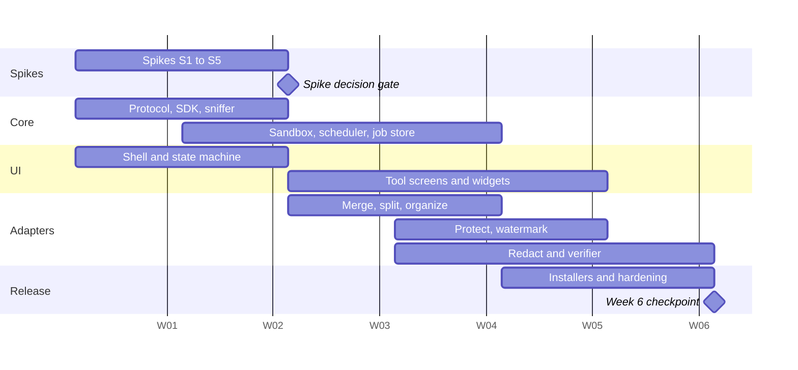
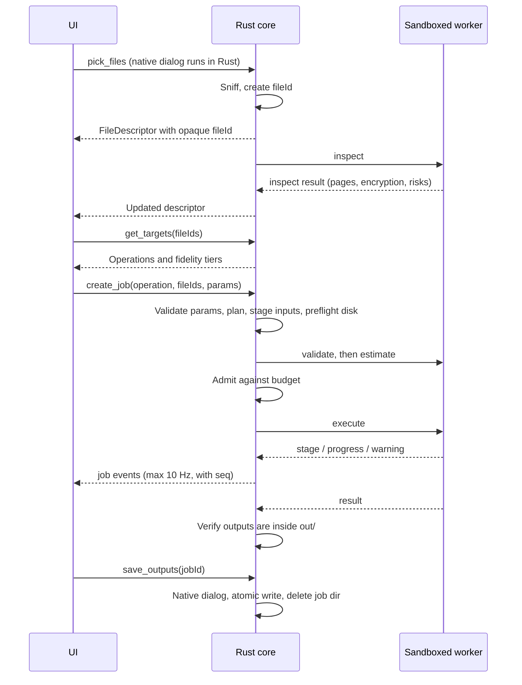
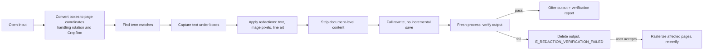

# Phase 1 Specification: Core Engine and PDF Manipulation

| | |
|---|---|
| **Status** | Approved, with changes C1 to C8 accepted on 2026-11-04 |
| **Timeline** | Weeks 1 to 6 |
| **Parent document** | [Architecture blueprint](../architecture/blueprint.md) |
| **Precedence** | Where this spec and the blueprint disagree, this spec wins (section 2) |

**Requirement words:** *must* is required for the exit gate; *should* is expected unless the team records a reason in an ADR; *may* is optional.

Numbers marked *(provisional)* are planning targets. The week 2 spikes replace them with measured values.

---

## 1. Outcome

At the end of week 6, a user on Windows, macOS or Linux can install a signed app and perform these operations on PDFs, entirely offline:

- Merge, split, and organize (reorder, rotate, delete pages)
- Protect and unlock
- Add a text or image watermark
- Redact, with verification that the content is really gone

### In scope

- Tauri shell, UI state machine, and page preview
- Sniffer that identifies all 12 planned formats (only PDF is actionable in this phase)
- Route planner, adapter SDK, worker protocol, conformance kit
- Scheduler, job store, garbage collection
- Sandboxes for all three operating systems
- Installers and CI for all three operating systems
- Risk spikes for later phases: LibreOffice in the sandbox, engine packaging, DOCX fidelity

### Out of scope

- Any format conversion adapter (Phase 2)
- PDF compression and OCR (Phase 3)
- Batch queues beyond the simple cases in section 8, and the Word adapter (Phase 3)
- Redaction of text in scanned pages by search (needs OCR; manual box redaction does work on them)
- Automatic updates of any kind (ruled out by the locked scope)

---

## 2. Changes to the blueprint

Writing this spec exposed problems in the approved blueprint. All eight changes below were **accepted on 2026-11-04** and replace the blueprint's text. C1 and C2 change security behavior.

| # | Blueprint said | This spec says | Why |
|---|---|---|---|
| C1 | Windows fallback for the sandbox: low integrity | **AppContainer is required.** A low-integrity fallback is allowed only for LibreOffice, is recorded as a known weakness, and needs an ADR | Low integrity blocks writes, but by default **does not stop reading the user's files**. It would not meet the goal of "a compromised worker can read nothing else" |
| C2 | Preview using PDF.js in the app's WebView | **No PDF.js in Phase 1.** A sandboxed worker renders pages to PNG, and the UI shows only those images | PDF.js would parse untrusted files in the same process that can call app commands. This also removes CSP exceptions and differences between OS WebViews. Cost: no selectable text in preview, which Phase 1 doesn't need |
| C3 | Hard-link inputs into the job directory | **Copy inputs,** using a filesystem clone where available | Hard links share one set of permissions. Granting the sandbox access to the link would also change the permissions on the user's original file |
| C4 | Network test fails on any packet | **Attribute traffic by process.** Our workers and app must send nothing. WebView runtime traffic is measured, minimized and disclosed | The OS WebView may make its own background connections. A blanket test could never pass, or would be quietly weakened later |
| C5 | Manifests declare only `edges` | Manifests declare **`edges` or `operations`** | Merge and redact are not format conversions, so they don't belong in the conversion graph |
| C6 | All forms generated from JSON Schema | **Schema forms plus named custom widgets** (`x-ui`) | Page organizing and drawing redaction boxes can't be generated from a schema |
| C7 | Linux sandbox: bubblewrap | Bubblewrap **plus an AppArmor profile in the `.deb`** | Ubuntu 24.04 restricts unprivileged user namespaces by default, so bubblewrap may otherwise fail |
| C8 | macOS: App Sandbox entitlement | **Spike chooses** between App Sandbox and per-job Seatbelt profiles | App Sandbox children inherit the parent's access, so isolation between jobs is weak. Direct distribution doesn't require App Sandbox |

---

## 3. Schedule



The calendar dates in the chart are placeholders; only the week offsets matter.

| Week | Milestone | Must be true |
|---|---|---|
| 1 | **Skeleton** | The repo builds on all three CI runners. An empty app launches. Names and owners are assigned (section 16) |
| 2 | **Spike gate** | Spikes S1 to S5 have written results and decisions |
| 3 | **Walking skeleton** | A fake adapter runs through the sandbox and reports progress to the UI, on all three OSes |
| 4 | **First real tools** | Merge, split and organize work end to end |
| 5 | **Feature complete** | Protect, watermark and redact work; conformance kit runs on every adapter |
| 6 | **Checkpoint** | All section 15 exit criteria evaluated on all three OSes |

### Week 6 checkpoint rule

If any exit criterion fails on any OS, the team chooses one of these within a week and records it in an ADR:

1. **Extend** Phase 1 by up to 2 weeks and shorten later phases accordingly.
2. **Cut features** in this order: image watermarks, split by file size, drag-to-reorder (keep numeric reorder), watermark layering.
3. **Delay one OS,** which requires explicitly reversing the "three OSes at launch" decision.

**Never cut:** sandbox enforcement, redaction verification, the network test, or the conformance kit.

---

## 4. Week 1 to 2 spikes

Each spike is time-boxed to its allowance, ends with a short report in `docs/spikes/`, and produces throwaway code that is not merged into the product.

| ID | Question | Pass criteria | If it fails |
|---|---|---|---|
| **S1** Sandbox | Can Python + pikepdf + PyMuPDF **and** LibreOffice run under each OS's sandbox? | Probe (section 9.3) shows no outside read, no write, no network. PDF job and `.docx → .pdf` both succeed | **PDF stack:** must pass, otherwise escalate the same week. **LibreOffice:** a fallback ADR per C1, with its weakness documented |
| **S2** Packaging | Can we build one installer per OS, with Python, the PDF stack, LibreOffice and WeasyPrint? | Installs on a clean VM and runs a merge offline. macOS build is notarized with all nested binaries signed. Real sizes recorded | **WeasyPrint:** switch MD → PDF to Typst, and re-plan HTML → PDF. **Notarization:** escalate at the gate |
| **S3** Rendering | Is worker-rendered preview fast enough? | Open a 500 MB PDF and show page 1 in ≤ 3 s; p95 page render ≤ 300 ms at 96 DPI *(provisional)* | Add a page cache and pre-rendering. Only if that fails, reconsider PDF.js in an isolated view |
| **S4** WebView traffic | What does each OS WebView send over the network while the app runs? | Traffic listed by process and destination. Any runtime traffic that can be turned off is off; the rest goes into the privacy doc | Consider a fixed WebView2 runtime; disclose what remains |
| **S5** DOCX fidelity | How close is LibreOffice to Word on 20 real documents? | Report with page-count match and per-page SSIM against PDFs exported from real Word, with and without bundled fonts. **Proposes the Phase 2 thresholds** | This spike can't fail; a poor result changes Phase 2 scope and is raised at the gate |

S1 also decides the macOS approach using these criteria, in order:

1. Can one job read another job's files?
2. Does it work with a notarized, directly distributed app?
3. What will it cost to maintain?

---

## 5. System flows

### 5.1 Happy path



### 5.2 Rules that apply everywhere

- **The renderer never supplies a file path.** Files enter through a native dialog or drop event handled in Rust. The UI holds only opaque IDs.
- **The renderer never parses untrusted content.** It shows PNGs produced by a sandboxed worker.
- **Everything from a worker is untrusted,** including its messages, paths and text (section 7.4).
- **The sandbox fails closed.** If the sandbox can't be applied, the job doesn't run. There is no "run anyway" setting.

---

## 6. Sniffer (`crates/sniffer`)

**Input:** a path. **Output:** a `FileDescriptor`. It reads only the first and last 64 KB, plus the ZIP central directory when needed (capped at 16 MB), and never decompresses or decodes content other than a bounded read of `[Content_Types].xml` (max 1 MB).

| Field | Type | Notes |
|---|---|---|
| `fileId` | opaque string | Random; never derived from the path |
| `displayName`, `sizeBytes` | | Display name is treated as untrusted text |
| `format` | enum | `pdf docx pptx xlsx md html txt png jpg webp svg heic`, or `unknown` |
| `confidence` | enum | `certain`, `likely`, `guess` |
| `evidence` | string[] | For example `magic:%PDF`, `zip:content-types:wordprocessingml` |
| `extensionMismatch` | bool | Content and extension disagree |
| `candidates` | enum[] | Set when the file is ambiguous or a polyglot |
| `encryptionHint` | enum | `none`, `maybe`, for PDF and legacy Office containers |
| `macroEnabled` | bool | OOXML macro content types |
| `cloudPlaceholder` | bool | File isn't stored locally (for example, OneDrive online-only) |
| `actionable` | bool | `true` only for PDF in Phase 1 |

**Behavior**

| Case | Result |
|---|---|
| `%PDF-` in first 1,024 bytes | `pdf`. No `%%EOF` in the tail → still `pdf`, with the evidence noted; `inspect` decides whether it's readable |
| `.pdf` extension but different content | Trust content; set mismatch |
| Valid as two formats | `candidates` is set and the user chooses |
| Supported format, not PDF | Shown as "Coming later", with no operations |
| Cloud placeholder | Don't read it. Ask before downloading, since reading triggers the download |
| Zero bytes, directory, or special file | Rejected, with a reason |
| Unreadable (locked, permissions) | Per-file error; other files continue |

**The encryption hint is only a hint.** Scanning for `/Encrypt` can't be reliable without parsing, so `inspect` gives the authoritative answer.

**Tests:** a table of at least 60 cases, including every format, renamed files, truncated files, polyglots, and non-ASCII and very long file names. A fuzz target must run at least 10 minutes in nightly CI with no panics.

---

## 7. Worker protocol (`packages/protocol`)

JSON Schema is the source of truth, generating TypeScript types, Rust types and Pydantic models. **Generated code is not committed by hand,** and CI fails if it's out of date.

### 7.1 Transport

- UTF-8 NDJSON over the worker's stdin and stdout. Maximum 1 MiB per line.
- All messages have `v` (protocol version), `type` and `jobId`.
- At startup, the SDK moves the protocol channel to a private descriptor and points file descriptor 1 at stderr, so that a library's stray `print` can't corrupt the protocol.
- stderr goes into a 256 KB in-memory ring buffer. It is never written to disk, because it may contain document text.
- When stdin closes, the worker must exit within 1 second. This is the backstop against orphaned processes on every OS.

### 7.2 Messages

| Direction | Type | Purpose | Key fields |
|---|---|---|---|
| Worker → core | `hello` | Handshake, within 10 s of launch | `adapterId`, `protocolVersion`, `pid` |
| Core → worker | `inspect` | Read-only facts about a file | `input`, `secrets?` |
| Core → worker | `validate` | Adapter-specific checks | `inputs`, `params`, `secrets?` |
| Core → worker | `estimate` | Resource estimate | `inputs`, `params`, `metadata` |
| Core → worker | `execute` | Do the work | `inputs`, `outDir`, `workDir`, `params`, `secrets?` |
| Core → worker | `render` | Page to PNG, for preview | `input`, `page`, `dpi`, `out`, `secrets?` |
| Core → worker | `pageText` | Word boxes, for redaction search and display | `input`, `page`, `secrets?` |
| Core → worker | `cancel` | Stop cooperatively | none |
| Worker → core | `stage` | Stage changed | `name`, `index`, `of` |
| Worker → core | `progress` | Progress within a stage | `stage`, `done`, `total?` |
| Worker → core | `warning` | Fidelity or safety note | `code`, `detail` |
| Worker → core | `result` | Success | Per message type; for `execute`, see below |
| Worker → core | `error` | Failure | `code`, `detail`, `retryable` |

**Example exchange (the password travels in `secrets`):**

```json
{"v":1,"type":"execute","jobId":"j_7f3a","inputs":["in/0.pdf"],"outDir":"out","workDir":"work","params":{"mode":"unlock","confirmRights":false},"secrets":{"password":"…"}}
{"v":1,"type":"stage","jobId":"j_7f3a","name":"decrypt","index":1,"of":2}
{"v":1,"type":"result","jobId":"j_7f3a","outputs":[{"path":"out/0.pdf","suggestedName":"report-unlocked.pdf","pages":12,"sizeBytes":81233,"sha256":"…"}],"fidelity":"E"}
```

### 7.3 Secrets

- Secrets appear only in the `secrets` field, and core logging must drop that field at the type level so it can't be logged by accident.
- Rust holds them in zeroizing types. Never put them on a command line, in an environment variable, or in a file.
- **JavaScript and Python strings can't be reliably wiped,** so the docs must say "cleared when no longer needed", not "erased from memory". Workers are short-lived, which limits exposure.

### 7.4 Core must distrust workers

| Check | On failure |
|---|---|
| Line exceeds limit, or fails schema | Kill the worker; `E_PROTOCOL` |
| `jobId` differs from the running job | Kill; `E_PROTOCOL` |
| Output path resolves outside `out/`, or is a symlink or reparse point | Kill; delete output; `E_PROTOCOL` |
| Claimed size or hash differs from the file | `E_PROTOCOL` |
| Output doesn't sniff as the declared format | `E_OUTPUT_INVALID` |
| Warning code isn't in the catalog | Show as generic warning; log the code |
| More than 1,000 messages per second | Kill; `E_PROTOCOL` |

All worker text is rendered as plain text in the UI, never as HTML, and is length-limited. `suggestedName` is sanitized before use.

### 7.5 Versioning

The protocol ships inside the app, so app and workers always match. A version mismatch on `hello` is treated as a broken install (`E_INSTALL_CORRUPT`). Phase 1 needs no compatibility layer.

---

## 8. Adapter SDK and manifest

### 8.1 Adapter layout

```
adapters/pdf-merge/
├── manifest.yaml
├── params.schema.json
├── adapter.py
├── tests/
└── README.md           # What it does, tier, known limits, engine, license
```

### 8.2 Manifest

```yaml
id: pdf-merge
kind: operation            # or "conversion"
title: Merge PDFs
workerClass: pdf           # Scheduler pool
inputs: { formats: [pdf], min: 2, max: 200 }
outputs: { format: pdf, cardinality: one }   # or "many"
fidelity: E
fidelityNotes: [FORMS_FLATTENED, TAGS_DROPPED]
limits: { timeoutBaseS: 60, timeoutSPerMb: 1, noProgressS: 120, diskFactor: 2.0 }
params: ./params.schema.json
platforms: [windows, macos, linux]
requires: [pikepdf]
```

Conversion adapters use `edges` in place of `inputs` and `outputs`, as in the blueprint. CI generates `registry.generated.json` from manifests (gitignored), and fails on duplicate IDs, unknown warning codes, undeclared engines or invalid schemas.

### 8.3 Adapter contract

The blueprint's four methods, with these precise rules. Adapters can also implement `inspect`; otherwise a shared PDF implementation is used.

| Method | Must | Must not |
|---|---|---|
| `validateInput(ctx, params)` | Return errors, warnings and metadata within 30 s | Write anywhere, or decode full page contents |
| `estimateMemory(ctx, params)` | Return `ramBytes`, `diskBytes`, `costUnits` within 1 s | Open anything beyond metadata already gathered |
| `executeConversion(ctx, params, emit)` | Write only to `ctx.outDir` and `ctx.workDir`; call `ctx.checkCancelled()` at least per page; emit a final result | Call `print` for status, read `os.environ`, use the network, or log document content |
| `cleanup(ctx)` | Be idempotent and tolerate a partial run | Be relied on for safety; the core deletes the job directory regardless |

The name `executeConversion` is kept for operations too, so there is one interface.

**SDK helpers:** `ctx.emit`, `ctx.checkCancelled`, `ctx.openPdf(input, secrets)`, `ctx.tempPath`, `ctx.outputPath(suggestedName)`, safe filename handling, and consistent error codes. Adapter code must use `ctx.openPdf` rather than opening files by itself, so that password handling and limits stay in one place.

### 8.4 Conformance kit (`workers/conformance`)

Runs automatically against every adapter, using its manifest:

| Check | Passes when |
|---|---|
| Corrupt and truncated input | Returns a structured error; no crash or hang |
| Encrypted input with no password | `E_PASSWORD_REQUIRED` |
| Output containment | Nothing is written outside `out/` and `work/` |
| Cancellation | Exits within 2 s of `cancel` |
| Memory estimate | Peak RSS ≤ 1.5 × estimate across the fixtures |
| Timeout | A hung-adapter fixture is killed by the supervisor |
| Output validity | qpdf `--check` passes; page count is as expected |
| Determinism of warnings | Every emitted warning is in the catalog and manifest |
| Secret handling | A sentinel password doesn't appear in stderr, output or `work/` |
| Statelessness | Repeat runs produce equivalent results (content, not timestamps) |

---

## 9. Sandbox (`crates/sandbox`)

### 9.1 Interface

`spawn(SandboxSpec) → SandboxedProcess`, where the spec holds the program, arguments, read-only paths, read-write paths, memory limit, CPU limit, and process limit. Operations are `wait`, `kill` and `peak_memory`. A separate `self_test()` runs the probe at first launch and after every update.

### 9.2 Per-OS requirements

| Requirement | Windows | Linux | macOS |
|---|---|---|---|
| Launch | AppContainer via `CreateProcess` with security capabilities; explicit handle list for pipes | Bubblewrap with `--unshare-all --die-with-parent --new-session` | Per spike S1 (C8) |
| Filesystem | Grant only the job dir to the container SID, and runtime directories for read | Read-only bind of runtime; read-write bind of job dir; no home | Profile or entitlements allowing the same |
| Network | No network capabilities (this includes loopback) | Empty network namespace | Denied |
| Memory limit | Job Object `JOB_OBJECT_LIMIT_JOB_MEMORY` | `RLIMIT_AS` plus RSS watchdog | RSS watchdog (`RLIMIT_AS` isn't reliable there) |
| Process limit | Job Object: 1 for PDF workers; set per engine | PID namespace + `RLIMIT_NPROC` | Profile denies process exec where possible |
| Kill the whole tree | `TerminateJobObject`; `KILL_ON_JOB_CLOSE` | Kill the PID namespace | Process group kill |
| Environment | Scrubbed and rebuilt | Scrubbed and rebuilt | Scrubbed and rebuilt |

**Install location trap on Windows:** Program Files is readable by AppContainers, but a per-user install in LocalAppData is not. The installer must grant the runtime directory read and execute access for the app's container.

**Linux trap:** see C7. The `.deb` includes the AppArmor profile. Other install routes must detect the failure and show instructions, not run without the sandbox. Phase 1 targets Ubuntu 24.04 LTS; other distributions are best effort.

**Stretch only:** seccomp filter on Linux, Win32k lockdown on Windows.

### 9.3 Probe

A test-only worker, **excluded from release adapter registries** but compiled into a small self-test routine:

| Attempt | Expected |
|---|---|
| Read a sentinel in the user's home | Denied |
| Read another job's directory | Denied |
| Write outside the job directory | Denied |
| Connect to an external address, and to a loopback listener | Denied |
| DNS lookup | Fails |
| Spawn a child process (PDF class) | Denied |
| Allocate past the memory limit | Worker dies; core reports `E_RESOURCE_MEMORY` |
| Read the job directory, write to `work/` | **Allowed** (shows that the probe isn't failing for the wrong reason) |

If the self-test fails, the app shows an error and disables processing.

---

## 10. Scheduler, job store and garbage collection

### 10.1 Job states (authoritative, in Rust)

`created → staging → validating → queued → running → verifying → succeeded | partial | failed | cancelled`

Every change appends an event with a per-app monotonically increasing `seq`. Jobs are held in memory only; **no job history persists on disk.**

### 10.2 Scheduling

- Budget: `min(60% of available RAM, user setting)`, re-read before each admission.
- A job's hard limit is `min(max(1.5 × estimate, 512 MB), budget)`.
- Admit the first job in the queue that fits. Skipping is allowed only if the skipped job isn't starved: after 60 s it blocks later jobs.
- A job larger than the whole budget runs alone, with `W_LARGE_JOB`.
- Failing on the memory limit retries **once**, alone, at the full budget. A second failure yields `E_RESOURCE_MEMORY`.
- Phase 1 pools: PDF structural 2, render 2, redact 1. Preview render requests are prioritized and superseded (scrolling away cancels pending pages).

### 10.3 Watchdog

- Total timeout: `timeoutBaseS + timeoutSPerMb × input MB`.
- No-message timeout: `noProgressS`.
- Core sends `cancel`, waits 2 s, then kills the process tree.

### 10.4 Job directory

```
<dataRoot>/jobs/<jobId>/
  .lease          PID and process start time (not PID alone: PIDs get reused)
  in/0.pdf        Staged copy, renamed; original name kept only in memory
  work/
  out/
```

`dataRoot` is `%LOCALAPPDATA%\<App>` on Windows, `~/Library/Application Support/<App>` on macOS (or the container), and `$XDG_CACHE_HOME/<App>` on Linux. **If `dataRoot` is in a known cloud-sync folder, the app refuses to process** and explains how to change it.

**Staging (C3):** clone if the filesystem supports it (APFS, Btrfs, XFS); otherwise copy, showing a "Preparing files" stage. Preflight requires free space of at least `sum(input size) × (1 + diskFactor)`.

**Permissions:** job directories are private to the user (`0700` or equivalent), with only the job's own sandbox granted access.

### 10.5 Garbage collection

| Trigger | Action |
|---|---|
| Job reaches a terminal state | Delete `work/`; on failure or cancel, delete `in/` and `out/` too |
| Saved or discarded | Delete the job directory |
| App exit | Delete all job directories, after killing workers |
| App start | Delete directories whose lease owner is gone |
| Delete blocked | Retry 5 times with backoff, then leave for next start |

The docs must not claim secure erasure.

### 10.6 Saving

- Rust opens the native save dialog; the renderer never sees or supplies the path.
- Write to a temp file in the destination folder, flush, then rename atomically. If moving across volumes, copy first.
- Multi-file output: choose a folder, and any name collision gets a numeric suffix. Never overwrite without the dialog's confirmation.
- Selecting one of the job's inputs as the save target requires an explicit confirmation.
- If the destination is in a known sync folder, show: "This folder syncs to the cloud." This is a notice and does not block saving.

Detect OneDrive, Dropbox, iCloud Drive and Google Drive using their documented locations and environment variables. **Detection is best effort,** and the docs must say so.

---

## 11. App interface

### 11.1 Commands

| Command | Purpose |
|---|---|
| `pick_files` | Open the native picker in Rust; returns descriptors |
| `remove_file(fileId)` | Forget a file |
| `resolve_file(fileId, {format?, allowDownload?})` | Resolve an ambiguous or online-only file |
| `submit_password(fileId, password)` | Re-inspect with a password; held in Rust until jobs finish |
| `get_targets(fileIds)` | Available operations with tiers and reasons |
| `create_job(operationId, fileIds, params)` | Returns `jobId`, or validation errors |
| `cancel_job(jobId)` | Cancel |
| `request_preview(ref, page, dpi)` | Returns a preview URL once rendered |
| `get_page_text(ref, page)` | Word boxes for the redaction UI |
| `save_outputs(jobId)` | Native dialog and atomic save |
| `discard_job(jobId)` | Delete |
| `get_snapshot()` | Current state and latest `seq`, for reload recovery |
| `get_diagnostics()` | Versions, self-test result, resource budget; **no file names or contents** |

`ref` is a `fileId` or an output ID, never a path. Drag and drop is handled through Tauri's native drop event in Rust, with the renderer's own file handling disabled. Rust validates every command's arguments.

### 11.2 Events

`job` events carry `seq`, `jobId`, `state`, `stage`, `progress` and new warnings, sent at no more than 10 Hz per job, while state changes and warnings are sent immediately. If the UI sees a gap in `seq`, it calls `get_snapshot`.

### 11.3 Preview images

Previews are served by a custom URI scheme, `preview://<random-token>/<n>.png`, implemented in Rust. Tokens map to a rendered file in a job directory, die with the job, and can't express a path. Only sandbox-rendered PNGs are served, with `Content-Type: image/png` and `X-Content-Type-Options: nosniff`.

### 11.4 Tauri security configuration

- **No** fs, shell, http, or updater plugins in the renderer's capabilities. Only named app commands.
- Single window, with one capability file listing every command.
- Navigation and new windows are blocked, and external links aren't opened from document content.

```
default-src 'none';
script-src 'self';
style-src 'self';
img-src 'self' preview: http://preview.localhost;
font-src 'self';
connect-src ipc: http://ipc.localhost;
base-uri 'none'; form-action 'none'; frame-src 'none'; object-src 'none'
```

The exact scheme forms differ by OS WebView, so confirm them in the walking skeleton. Any change requires review by the Core owner.

---

## 12. UI

### 12.1 State machine

Use the blueprint's section 7 machine, in XState v5, with these Phase 1 details:

- The machine holds view state only. Job state always comes from Rust. On reload, `get_snapshot` restores the correct state.
- `NeedsInput` covers password, ambiguous format and online-only file prompts.
- `Failed` covers total failure. **A verification failure on redaction always lands here,** with no output available.
- Model tests must cover every transition, and generated path tests must cover all states.

### 12.2 Screens

| Screen | Contents |
|---|---|
| **Home** | Dropzone, "Choose files" button, the six tools, "Processed on your device" with a link to what that means |
| **File review** | Detected type, page count, warnings, per-file errors, password prompt |
| **Tool** | Generated form and custom widgets, live validation, fidelity badge and caveats |
| **Progress** | Stage list, progress or an honest indeterminate bar, log, Cancel |
| **Result** | Preview, warnings, output sizes, Save, Adjust, Discard |
| **Settings** | Memory budget, limits within their ceilings, diagnostics, licenses and source link |

### 12.3 Custom widgets (`x-ui`)

| Widget | Used by | Requirements |
|---|---|---|
| `pageRanges` | Split, watermark | Parses `1-3, 5, 8-`; shows errors inline; validates against page count |
| `pageOrganizer` | Organize, merge | Virtualized thumbnails; drag and keyboard reorder; rotate; delete. Must hold up at 5,000 pages |
| `redactionCanvas` | Redact | Draw, select and remove boxes; word snapping; term search with results list; undo |
| `password` | Protect, unlock | Masked, reveal toggle, never retained in machine context after submission |
| `fileOrder` | Merge | Reorder files with keyboard and pointer |
| `imagePicker` | Watermark | Goes through the Rust picker and sniffer |

### 12.4 Accessibility minimum

Everything must be operable with the keyboard, including an alternative to dragging. Progress uses `aria-live`. Fidelity badges and warnings use text as well as color. The redaction canvas must offer a keyboard-accessible route to apply search terms and page-level selections, with box drawing by keyboard as a *should*.

---

## 13. Adapter specifications

Every adapter must pass conformance. Below, **E** means no generational loss of page content.

### 13.1 Warning and error catalog

| Warning | Meaning |
|---|---|
| `FORMS_FLATTENED` | Form fields became static content |
| `XFA_UNSUPPORTED` | XFA form content may not display correctly |
| `SIGNATURE_INVALIDATED` | A digital signature is no longer valid after this change |
| `TAGS_DROPPED` | Accessibility tags weren't preserved |
| `OUTLINE_DROPPED` | Bookmarks weren't preserved |
| `ACTIVE_CONTENT_FOUND` | Input has JavaScript or attachments |
| `NO_TEXT_LAYER` | Pages have no text, so search can't find content in them |
| `REDACTED_TEXT_REMAINS_ELSEWHERE` | Text under a box also appears elsewhere (count and pages) |
| `GLYPH_UNSUPPORTED` | The watermark font lacks some characters |
| `W_LARGE_JOB` | Exceeds the budget; running alone |

| Error | Retryable | Meaning |
|---|---|---|
| `E_INPUT_CORRUPT` | No | File can't be parsed |
| `E_PASSWORD_REQUIRED`, `E_PASSWORD_WRONG` | Yes | Needs a correct password |
| `E_LIMIT_EXCEEDED` | No | A section 6.2 blueprint limit was exceeded |
| `E_RESOURCE_MEMORY`, `E_RESOURCE_DISK` | Yes | Not enough resources |
| `E_TIMEOUT` | Yes | Watchdog expired |
| `E_CANCELLED` | n/a | User cancelled |
| `E_PROTOCOL`, `E_OUTPUT_INVALID` | No | Worker misbehaved |
| `E_SANDBOX_UNAVAILABLE`, `E_INSTALL_CORRUPT` | No | Needs a repair or a fix to the system |
| `E_REDACTION_VERIFICATION_FAILED` | No | Redaction couldn't be proven; no output |
| `E_INTERNAL` | Yes | Unexpected error |

Every code needs user text in the "what happened, why, what to do" pattern. The text lives in one catalog file so that CI can check for missing entries.

### 13.2 Shared PDF rules

- **Forms:** where an operation would break AcroForm fields, generate appearance streams and flatten, raising `FORMS_FLATTENED`.
- **XFA:** warn with `XFA_UNSUPPORTED`.
- **Signatures:** if the input is signed, warn *before* execution, then raise `SIGNATURE_INVALIDATED`.
- **Encrypted input:** must be opened using a password supplied by the user. Output of non-protect tools isn't encrypted, and the UI says so before running.
- **Metadata:** preserved unless the operation says otherwise. The output's Producer field must not reveal paths.
- **Saving:** full rewrite, with `compress_streams` on, and qpdf check after writing.

### 13.3 `pdf-merge` (pikepdf)

| Param | Type | Default |
|---|---|---|
| `order` | fileId[] | Selection order |
| `bookmarks` | `keep`, `perFile`, `none` | `perFile` |
| `metadataFrom` | fileId or `none` | First file |

**Behavior:** concatenates pages at original size. `perFile` creates one top-level bookmark per file (titled with its file name) with original bookmarks nested. Tag trees aren't merged in Phase 1, so tagged input raises `TAGS_DROPPED`.

**Acceptance**
- Page count is the sum of the inputs, and per-page render equals the source (SSIM ≥ 0.999).
- Mixed sizes and rotations are preserved.
- Two inputs with the same form field names don't corrupt each other (flattened, with a warning).
- Bookmarks navigate to the right pages.
- The same file used twice works.

### 13.4 `pdf-split` (pikepdf)

| Param | Type | Default |
|---|---|---|
| `mode` | `ranges`, `everyN`, `eachPage`, `maxSize` | `ranges` |
| `ranges` | string (`pageRanges`) | Required for `ranges` |
| `n` | int ≥ 1 | Required for `everyN` |
| `maxSizeMb` | int ≥ 1 | Required for `maxSize` (*cuttable*) |

**Behavior:** output is `<stem>_part-001.pdf`, padded to fit the total. Each output contains only the objects it needs. `maxSize` is best effort, and one oversized page yields one oversized part. Bookmarks that point to included pages are kept.

**Acceptance**
- Every requested page lands in the right output, in order.
- An output's size is close to its content, showing that unrelated pages' resources weren't retained.
- `eachPage` on a 5,000-page file completes under the memory limit, reporting per-part progress.
- Invalid ranges are caught in the UI and again in `validateInput`.

### 13.5 `pdf-organize` (pikepdf)

| Param | Type | Notes |
|---|---|---|
| `pages` | `{source: int, rotate: 0/90/180/270}`[] | The final page order. Omitted pages are deleted; duplicates are allowed |

**Behavior:** rotation is relative to the page's existing rotation. An empty list is rejected.

**Acceptance**
- Reorder, delete, duplicate and rotate each produce the expected pages.
- Already-rotated pages end up at the correct final angle.
- Bookmarks to deleted pages are removed, and the rest stay valid.

### 13.6 `pdf-protect` (pikepdf), two modes

**Mode `protect`**

| Param | Type | Notes |
|---|---|---|
| `secrets.userPassword` | string | Required to open the file |
| `secrets.ownerPassword` | string, optional | If absent, generate a random one that is not stored or shown |
| `permissions` | print, copy, modify, annotate | All true by default |

Uses AES-256 (revision 6). An already-encrypted input must be unlocked first. The UI must state that **permissions are honored voluntarily by PDF viewers and aren't real access control,** and that a lost password can't be recovered.

**Mode `unlock`**

| Input state | Behavior |
|---|---|
| Has an open password | Requires the correct password. **No guessing, retry automation, or cracking features** |
| Permissions-only password | Requires `confirmRights: true`, from a checkbox saying the user has the right to remove the restrictions |
| Not encrypted | Rejected as unnecessary |

**Acceptance**
- Round trip gives equal page content.
- Other tools (qpdf, a second engine) confirm the encryption method and permission flags.
- A wrong password gives `E_PASSWORD_WRONG`.
- Non-ASCII passwords work across both engines.
- A sentinel password appears nowhere in logs, stderr, `work/` or process arguments.

### 13.7 `pdf-watermark` (pikepdf + ReportLab)

| Param | Type | Default |
|---|---|---|
| `type` | `text`, `image` | `text` |
| `text`, `fontSize`, `color` | | Required for `text` |
| `imageFileId` | PNG or JPG | Required for `image` (*cuttable*) |
| `opacity` | 0.05 to 1.0 | 0.3 |
| `rotation` | -180 to 180 | 45 |
| `position` | Center, corners, or `tile` | Center |
| `layer` | `over`, `under` | `over` (*cuttable*) |
| `pages` | `pageRanges` | All |

**Behavior**
- Build one stamp PDF per distinct displayed page size and rotation, cached for the job.
- Position relative to what the viewer sees: **the CropBox after `/Rotate` is applied.**
- Bundle one font (Noto Sans). Characters it can't show raise `GLYPH_UNSUPPORTED`.
- Image watermarks are untrusted input too: they go through the sniffer, a header-based pixel limit, and the same sandbox.
- The UI should state that a watermark is a label, and doesn't stop anyone from removing it.

**Acceptance**
- Correct placement on 0, 90, 180 and 270° pages, and on pages with a non-zero CropBox origin, checked by rendering.
- Pages outside the selection are pixel-identical to the source.
- Output text stays extractable.
- A 5,000-page job shares one stamp, so file size grows only slightly.

### 13.8 `pdf-redact` (PyMuPDF + pypdfium2 + pikepdf)

This is the highest-risk tool in Phase 1: **a false "redacted" is much worse than a failed job.**

| Param | Type | Notes |
|---|---|---|
| `boxes` | `{page, x0, y0, x1, y1}`[] | Normalized 0 to 1 **in displayed page orientation,** as drawn in the UI |
| `terms` | string[] | Literal text search, whole document, case-insensitive |
| `fill` | `black`, `white` | `black` |
| `rasterizeFallback` | bool | Default false. Set only after the user accepts the fallback offer |

Metadata stripping is always on and not configurable.

**Pipeline**



**Strip step.** Remove: Info fields other than a neutral Producer, XMP metadata (document and per-object), attachments, all annotations and widgets, JavaScript and actions, page thumbnails, `/PieceInfo`, hidden optional-content layers, bookmarks that contain a term, and unreferenced objects. Removing form fields and annotations must be stated to the user *before* running.

**Verification.** It runs in a **new process that sees only the output file and a list of what to check,** using two engines so that one engine's blind spot can't pass silently:

| ID | Check | On failure |
|---|---|---|
| V1 | PyMuPDF: no characters intersect any redacted region | Fail |
| V2 | pypdfium2: same check, independently | Fail |
| V3 | Both engines: no search term in the full text, with whitespace and hyphenation normalized | Fail |
| V4 | Decode every stream and string with pikepdf; no term in raw form (Latin-1, UTF-8, UTF-16BE) | Fail |
| V5 | No Info fields except Producer, no XMP, attachments, annotations, JavaScript, thumbnails or hidden layers | Fail |
| V6 | At 150 DPI, each redacted region is entirely the fill color | Fail |
| V7 | File has a single revision: one `startxref`, and no incremental update | Fail |
| V8 | Page count equals the input's | Fail |
| V9 | Text captured from boxes doesn't appear elsewhere | **Warning** `REDACTED_TEXT_REMAINS_ELSEWHERE`, with count and pages. Not a failure, since a user may redact one instance only. The Result screen must show this prominently |

Reports must show what was checked, and say "passed these checks" rather than "guaranteed".

**Rasterize fallback.** On user consent, affected pages become images at 200 DPI, with redactions burned in, and verification runs again. Text on those pages is lost, and the UI must say so.

**Known limits to publish in the docs**
- Search can't find text inside scanned images; a `NO_TEXT_LAYER` warning appears when a page has images and no text.
- A box's size can hint at the length of the hidden content.
- Embedded font subsets may reveal which characters were used in the document, though not where.
- Content that's meaningful elsewhere (a name in a chart image, for example) isn't detected.

**Acceptance tests.** Each fixture has known secret strings, and the test fails if any of them can be recovered:

| Fixture | Proves |
|---|---|
| Plain text, in boxes and by term | Basic removal |
| Rotated pages (90, 180, 270) and non-zero CropBox | **Boxes land on the right content** |
| Text split across content operators, or across lines | Term search and V3 normalization |
| Invisible text (render mode 3), and text under an image | Hidden text removal |
| Text in a Form XObject | Nested content; if unsupported, verification must fail and offer the fallback |
| Image partly under a box | Pixels are actually changed |
| Secrets in metadata, XMP, attachments, annotations, form values, bookmarks, thumbnails, and hidden layers | Strip step |
| A prior incremental save that still holds the old text | Rewrite removes history |
| Deliberately sabotaged output (black rectangle only) | **Verifier catches it; this is the key test of the verifier itself** |
| Scanned page | Box redaction works; term search warns with `NO_TEXT_LAYER` |

---

## 14. Packaging and CI

### 14.1 Python runtime

Use **python-build-standalone with locked wheels** in an unpacked directory, launched with isolated mode (`-I`). Avoid single-file bundlers, which extract slowly and tend to attract antivirus false positives. Tauri's `externalBin` expects single binaries, so the runtime ships as resources, launched by the supervisor. S2 confirms this works with macOS code signing, where nested binaries may need to sit in a different bundle location.

### 14.2 Targets

| OS | Format | Signing | Notes |
|---|---|---|---|
| Windows 10/11 x64 | NSIS, per-user | Authenticode; evaluate SignPath Foundation for open source projects | Offline WebView2 installer mode, so install needs no network. Handles the runtime ACL (section 9.2) |
| macOS 13+ (arm64 and x64) | DMG | Developer ID and notarization (paid Apple Developer membership) | Sign every nested binary |
| Ubuntu 24.04 x64 | `.deb` | Signed checksums | Includes AppArmor profile. AppImage is deferred, as it can't install one |

The Phase 1 installer contains no LibreOffice, since no Phase 1 tool uses it; S2 still measures the full installer's size. Windows on ARM and Linux on ARM are out of scope.

### 14.3 AGPL compliance from the first release

- `LICENSE` at repo root, and AGPL headers per project policy.
- Settings shows third-party licenses, plus the exact source link and commit for the running build.
- Each release has a matching source tag, and the build instructions are public.

### 14.4 CI

| Trigger | Runs |
|---|---|
| Every PR | Format, lint, typecheck, unit tests, generated-code freshness, license check, affected adapters + conformance. **All three OSes** |
| Merge to main | Full adapter suite, sandbox probe, installer build on all three OSes |
| Nightly | Fuzzers, 500 MB performance tests, malformed-PDF suite, network test, `cargo-audit`, `pip-audit` |
| Release tag | Sign, notarize, SBOM, license report, clean-VM smoke test |

Fixture PDFs are built by scripts wherever possible. **Large fixtures are generated in CI, not committed.** Files with real personal data are never allowed in the corpus.

### 14.5 Network test (C4)

1. Run the full app flow with a packet capture on the test machine (`pktmon` on Windows, `tcpdump` on macOS and Linux).
2. Attribute traffic by process and destination.
3. **Fail** on any traffic from a worker, or from the app's own processes.
4. Compare any WebView runtime traffic with the allowlist from S4. A new destination fails the test.
5. Include a positive control, so that a test harness that captures nothing counts as a failure rather than a pass.
6. Run the corpus with canary links pointing to a local listener, and fail if it receives any request.

---

## 15. Phase 1 exit criteria

Every item must pass **on Windows, macOS and Linux**, from an installed build, unless stated otherwise. Reference machine: 4 cores, 8 GB RAM, SSD.

| # | Criterion | Evidence |
|---|---|---|
| 1 | Clean-VM install and first merge with networking disabled | Release smoke test |
| 2 | Merge two 500 MB PDFs: no UI frame gap over 100 ms, p95 frame ≤ 33 ms, completes in ≤ 120 s *(provisional)* | Perf test with frame recorder |
| 3 | Peak worker RSS for criterion 2 is ≤ 1.5 × estimate, and within the budget | Perf test |
| 4 | Killing a worker gives a clean job failure, with no orphans | E2E test |
| 5 | Killing the app ends all workers within 2 s; next launch removes the leftovers | E2E test |
| 6 | Cancel stops any job within 3 s, and leaves no files | Conformance + E2E |
| 7 | Sandbox probe passes every line in section 9.3 | CI and first-run self-test |
| 8 | Sandbox failure disables processing, with no way to run unsandboxed | Fault-injection test |
| 9 | All six adapters pass conformance and section 13 acceptance | CI |
| 10 | **All redaction fixtures pass, including the sabotaged-output test** | CI, plus manual review by someone other than the author |
| 11 | Sniffer tables pass and fuzzing runs without panics | CI |
| 12 | Malformed-PDF suite: no hangs or crashes of the core, all errors structured | Nightly |
| 13 | Network test passes (section 14.5) | Nightly + release |
| 14 | A new adapter ships with **no changes to shared files**, demonstrated by adding a sample | PR |
| 15 | State machine model tests cover all transitions; reload during a job recovers | CI |
| 16 | Keyboard-only run of every tool except box drawing | Manual checklist |
| 17 | Spike reports are complete, and Phase 2 thresholds are proposed | `docs/spikes/` |
| 18 | License check passes; source link and notices appear in Settings | CI + manual |

---

## 16. Work breakdown

### Owners

| Stream | Scope in Phase 1 |
|---|---|
| **Core** | Sniffer, sandbox, scheduler, job store, GC, commands, S1 |
| **Frontend** | Shell, state machine, widgets, screens, S3 (with PDF) |
| **PDF** | SDK, six adapters, verifier |
| **Documents** | S2 packaging, S5 fidelity, packaging pipeline, installers, signing |
| **QA and Security** | Conformance kit, corpus, probe, network test, S4, CI |

### Tasks

Effort: **S** up to 2 days, **M** up to 1 week, **L** up to 2 weeks (one person, part-time).

| ID | Task | Owner | Size | Depends on | Week |
|---|---|---|---|---|---|
| T01 | Move repo out of OneDrive; monorepo, tooling, CI on three OSes, CODEOWNERS | Core | M | | 1 |
| T02 | Protocol schemas and codegen | Core | M | T01 | 1 |
| T03 | Sniffer with test table and fuzz target | Core | M | T01 | 1-2 |
| T04 | Spikes S1 to S5 | Various | L | T01 | 1-2 |
| T05 | Tauri shell, capabilities, CSP, custom preview scheme | Frontend | M | T01 | 1-2 |
| T06 | SDK and fake adapter | PDF | M | T02 | 2 |
| T07 | Manifest schema, registry generator, route planner with fixture manifests | Core | M | T02 | 2 |
| T08 | Job store, staging, GC, save flow | Core | M | T02 | 2-3 |
| T09 | Sandbox: Windows | Core | L | T04 | 2-4 |
| T10 | Sandbox: Linux, macOS | Core + QA | L | T04 | 2-4 |
| T11 | Probe and self-test | QA | M | T09, T10 | 3 |
| T12 | Scheduler, watchdog, supervisor message checks | Core | M | T06, T08 | 3 |
| T13 | XState machine with model tests, screens, generated forms | Frontend | L | T05 | 2-4 |
| T14 | Conformance kit and base corpus | QA | M | T06 | 3-4 |
| T15 | `pdf-merge`, `pdf-split`, `pdf-organize` | PDF | L | T06, T14 | 3-4 |
| T16 | `pageOrganizer`, `pageRanges`, `fileOrder`, render worker | Frontend + PDF | L | T12, T13 | 3-5 |
| T17 | `pdf-protect`, `password` widget | PDF | M | T15 | 4-5 |
| T18 | `pdf-watermark`, `imagePicker` | PDF | M | T15 | 4-5 |
| T19 | `pdf-redact`, verifier, adversarial fixtures | PDF + QA | L | T15 | 4-6 |
| T20 | `redactionCanvas` | Frontend | L | T16 | 4-6 |
| T21 | Installers, signing, notarization, AGPL notices | Documents | L | T04 | 4-6 |
| T22 | Network test, malformed-PDF suite, performance tests | QA | M | T12, T21 | 5-6 |
| T23 | Accessibility pass, error text, docs for known limits and privacy | Frontend + all | M | T13 | 5-6 |
| T24 | Exit review and checkpoint decision | All | S | All | 6 |

**Critical path:** T01 → T04 → T09/T10 → T12 → T15 → T19 → T24.

**Biggest staffing risk:** Core carries T03, T07, T08, T09, T10 and T12 within the first four weeks, which is more than one part-time person can do. Plan for the QA and PDF owners to take on T07 and T10 with Core reviewing.

### Definition of done for any task

- Merged through a PR, reviewed by someone else, passing CI on all three OSes
- Tests included, and failure modes tested as well as success
- No document content or secrets in logs
- Docs updated when behavior or limits change

---

## 17. Needed before week 1 ends

| # | Decision or action | Owner | Why it can't wait |
|---|---|---|---|
| 1 | **Everyone clones the repo outside OneDrive** and other sync folders | Everyone | Test files and builds would otherwise sync to the cloud |
| 2 | **Confirm the product name and bundle identifier.** Currently "Local File Conversion Suite" and `io.github.shamith-s-poojari.local-file-conversion-suite` | Team | Needed for data paths, signing and AppContainer names, and painful to change later |
| 3 | **Name one owner per stream,** and a backup for Core | Team | Three-OS sandbox work can't depend on one person |
| 4 | **Get an Apple Developer membership and a Windows signing route** | Documents owner | Approval can take weeks, and it blocks criterion 1 |
| 5 | **Access to real Word for one person** | Documents owner | S5 needs reference PDFs |
| 6 | **Hardware or VMs for each OS,** including a Mac | QA owner | CI alone can't test installers and clean-VM runs |
| 7 | **Pin engine versions** with lockfiles and record licenses | Core and PDF | This spec intentionally names no versions, and they must be checked for current security fixes on the day of pinning |
